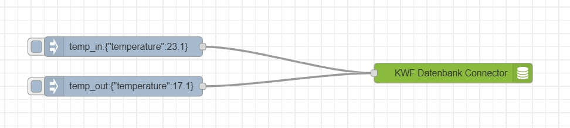

# KWF Energiemonitor: Node-RED-Connector

**Status:** Beta, produktiv im Langzeittest (Version 0.4.2). npm: [`@vereinkleinwohnformen/node-red-energiemonitor`](https://flows.nodered.org/node/@vereinkleinwohnformen/node-red-energiemonitor)

Teil des [KWF Energiemonitors](https://github.com/Verein-Kleinwohnformen/energiemonitor-docs), einem offenen Messsystem für Kleinwohnformen, gebaut für die Energiestudie mit der HSLU und für den [Verein Kleinwohnformen](https://kleinwohnformen.ch). Der Energiemonitor ist kein Produkt, sondern eine offene Plattform zum Nachbauen. Einstieg, Bauanleitung und Glossar: [energiemonitor-docs](https://github.com/Verein-Kleinwohnformen/energiemonitor-docs).

## Was der Connector macht
Dieser Node ist der Kernbaustein des KWF Energiemonitors. Du musst dich nur noch darum kümmern, die gewünschten Datenkanäle einzulesen, und sie in einem passenden Intervall mit dem richtigen Topic an diesen Baustein (KWF Datenbank-Connector) zu schicken, und dieser Block übernimmt den Rest, nämlich:
- Daten in einer lokalen Datenbank zwischenspeichern
- Daten regelmässig (1 mal pro Stunde) oder wenn wieder eine Internetverbindung vorhanden ist, an die Datenbank zu schicken.

So sieht eine Beispiel-Konfiguration aus. Deine NodeRED-Bausteine sollten noch folgende Aufgaben übernehmen:
- Daten ggf. aggregieren und in der empfohlenen Frequenz an diesen Connector schicken (Idee: Zukünftig könnte auch dieser Konnektor Daten aggregieren, um Fehler und falsche Inputs in der Datenbank zu vermeiden)
- Das richtige Format sicherstellen
- Das richtige Topic anfügen

Das sieht dann so aus. Auf der linken Seite hast du deine Mess-Blocks, die alle mit unserem Connector verbunden sind.


### Installation
Dieser Node ist bereits in der [NodeRED-Library](https://flows.nodered.org/node/@vereinkleinwohnformen/node-red-energiemonitor) verfügbar.

### Konfiguration
Diese Parameter müssen konfiguriert werden:
- Einen Pfad, auf dem Daten persistent gespeichert werden können (für die Datenbank zur Zwischenspeicherung). Für eine Einrichtung auf Balena den Default-Wert beibehalten. Im Fall von Datenbank-Fehlern (z.B. alte Version des Blocks hat bereits ein anderes Datenbank-Format) kann es helfen, den Namen des Datenbank-Files auszutauschen.
- Sende-Intervall (ms), in dem die Daten an die Datenbank gesendet werden. Zum Testen ca. 1 Minute nehmen und im Betrieb 1 Stunde (Default).
- Die URL der API, am besten aus der Balena-Variable `KWF_URL` übernehmen. In Variante A (Mitmachen im KWF-System) ist das die KWF-API, in Variante B deine eigene.
- Deinen Device API-Key, am besten aus der Balena-Device-Variable `KWF_KEY` übernehmen. In Variante A vergibt ihn das Team, siehe [Variante A](https://github.com/Verein-Kleinwohnformen/energiemonitor-docs/blob/main/docs/variante-a-mitmachen.md).

### Input-Datenformat

Das Input-Datenformat basiert jetzt auf Messpunkten (measurement_point), die für jede Wohneinheit separat definiert werden. Jeder Sensor hat eine eindeutige ID und jeder Datenpunkt wird einem spezifischen Messpunkt zugeordnet.

**Wichtig:** Topics werden nicht mehr verwendet. Alle Informationen werden in `msg.payload` übertragen.

#### Grundlegendes Format

```json
{
  "values": {
    // Sensor-spezifische Messwerte
  },
  "sensor_id": "eindeutige-sensor-id",
  "timestamp": 1760084970005,
  "metering_point": "XX"
}
```

#### Messpunkte

Die Messpunkte (E1, E2, E3, M0, M1, M2, A1, I1 bis I3, K0 bis K4, D1, NA) sind an einer Stelle definiert: [Glossar der Messpunkte](https://github.com/Verein-Kleinwohnformen/energiemonitor-docs/blob/main/docs/messpunkte.md).

#### Beispiele für verschiedene Sensortypen

**230V Stromklemmen (z.B. Shelly 3EM Pro):**

```json
{
  "values": {
    "voltage": 231.27,
    "act_power": 14.555,
    "pf": 0.33,
    "aprt_power": 44.35
  },
  "sensor_id": "shelly-3em-pro",
  "timestamp": 1760084970005,
  "metering_point": "E1"
}
```

**Netatmo Wetterstation:**

```json
{
  "values": {
    "device_id": "aa:bb:cc:dd:ee:01",
    "device_reachable": true,
    "wifi_signal_strength": 65,
    "temperature_indoor": 19.8,
    "humidity_indoor": 51,
    "co2_indoor": 460,
    "pressure": 1028.9,
    "noise_level": 32,
    "pressure_absolute": 976.5,
    "outdoor_module_reachable": true,
    "outdoor_module_id": "aa:bb:cc:dd:ee:02",
    "temperature_outdoor": 18.4,
    "humidity_outdoor": 60,
    "battery_level": 100,
    "rf_signal_strength": 53,
    "battery_voltage": 6116,
    "temperature_difference": 1.4
  },
  "sensor_id": "netatmo",
  "timestamp": 1760086636000,
  "metering_point": "K0"
}
```

#### Per-Value Timestamps mit `ts_` Prefix (v0.4.2+)

Der Node unterstützt **individuelle Timestamps für jeden Messwert** über das `ts_` Präfix-System. Dies ist besonders nützlich für Sensoren, die ihre Messwerte in unterschiedlichen Intervallen aktualisieren.

**Wie es funktioniert:**

- Für jeden Messwert kann ein individueller Timestamp mit dem Präfix `ts_` angegeben werden
- Der Node gruppiert automatisch Werte mit gleichen Timestamps in separate Datenbankeinträge
- Werte ohne `ts_` Präfix werden in alle Datenbankeinträge übernommen (z.B. Metadaten)
- Vollständig rückwärtskompatibel: Funktioniert auch ohne `ts_` Präfixe

**Beispiel: Netatmo mit individuellen Timestamps**

```json
{
  "values": {
    "ts_temperature_indoor": 1761140223000,
    "temperature_indoor": 19.6,
    "ts_humidity_indoor": 1761140223000,
    "humidity_indoor": 51,
    "ts_temperature_outdoor": 1761140210000,
    "temperature_outdoor": 18.8,
    "ts_humidity_outdoor": 1761140210000,
    "humidity_outdoor": 64,
    "wifi_signal_strength": 67,
    "device_id": "aa:bb:cc:dd:ee:01"
  },
  "sensor_id": "netatmo",
  "timestamp": 1761140877000,
  "metering_point": "K0"
}
```

**Resultierende Datenbankeinträge:**

```
Eintrag 1: timestamp=1761140223000
  - temperature_indoor: 19.6
  - humidity_indoor: 51
  - wifi_signal_strength: 67
  - device_id: "aa:bb:cc:dd:ee:01"

Eintrag 2: timestamp=1761140210000
  - temperature_outdoor: 18.8
  - humidity_outdoor: 64
  - wifi_signal_strength: 67
  - device_id: "aa:bb:cc:dd:ee:01"
```

**Vorteile:**

- ✅ Präzise Zeitstempel für jede Messung
- ✅ Automatische Gruppierung nach Timestamp
- ✅ Metadaten werden in alle Einträge übernommen
- ✅ Verhindert Duplikate durch intelligente Merge-Logik
- ✅ Universal einsetzbar für beliebige Sensoren

## Unterstützte Sensortypen

Der Connector verlangt nur, dass `sensor_id` und `metering_point` gesetzt sind (die API validiert die Daten zusätzlich). Diese IDs sind in der Praxis im Einsatz (Definition im [Glossar](https://github.com/Verein-Kleinwohnformen/energiemonitor-docs/blob/main/docs/messpunkte.md)):

| Sensortyp | Sensor ID | Typische Messpunkte | Gemessene Werte |
|---|---|---|---|
| Shelly Pro 3EM | `shelly-3em-pro` | E1, E2, E3, A1, I1, I2, I3 | voltage, current, act_power, aprt_power, pf |
| Peacefair PZEM-017 (DC) | `pzem-017` | E3 und weitere DC-Punkte | voltage, current, power |
| Netatmo Wetterstation | `netatmo` | K0 (K1 bis K4) | Temperatur, Luftfeuchtigkeit, CO2, Luftdruck, Lärm, Batterie, Signal |
| Victron GX (Cerbo, Venus) | `victron` | E1, E2, E3 | power |
| Sensirion Smart Gadgets (BLE, über MQTT) | `sensirion` (prüfen) | K1, K3, K4 | Temperatur, Feuchte, CO2, VOC |
| Wasserzähler | (prüfen) | D1 | Verbrauch in m³ |

## Todo

- Aggregation der Messdaten im Connector statt in den Flows, damit weniger Daten in die Cloud gehen
- Basis-Sensoren des Energiemonitor-Kits einbinden
- Weitere Victron-Datenformate

Erledigt: Victron Cerbo GX läuft produktiv.

## Lizenz

Apache License 2.0, siehe [LICENSE](LICENSE). Fragen: [energiemonitor@kleinwohnformen.ch](mailto:energiemonitor@kleinwohnformen.ch)
